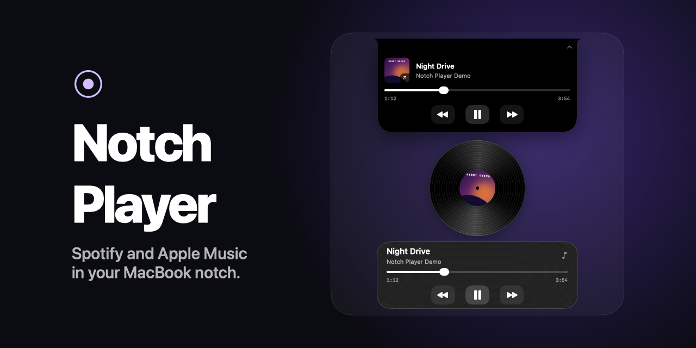

# Notch Player

**Spotify and Apple Music in your MacBook notch.** An open-source Dynamic Island for macOS with playback controls, live album art, and a spinning record on the lock screen.

[Try it on your Mac](#quick-start) · [Find a first contribution](#contribute) · [Report a bug](https://github.com/andy1924/notch-player/issues/new?template=bug_report.md)



[](https://github.com/andy1924/notch-player/actions/workflows/macos.yml)
[](LICENSE)

## What you can do

- **Control music from the notch.** Hover to grow the notch slightly, then click to open with trackpad feedback. Play, pause, skip, scrub, or click the album art to jump to the Spotify or Music app.
- **See a record on the lock screen.** Switch between a spinning vinyl record, album art, and lyrics. Use **Preview Lock Screen** from the menu bar to try the player while unlocked.
- **Use it on a Mac without a notch.** The compact player appears as a floating pill on that display.

If you’d like to follow the project, [star Notch Player](https://github.com/andy1924/notch-player). A short report from your Mac is also a contribution.

## Quick start

Notch Player currently builds from source. You’ll need **macOS 14 or later** and **Xcode**.

```sh
git clone https://github.com/andy1924/notch-player.git
cd notch-player
./scripts/build.sh
open "dist/Notch Player.app"
```

Play a track in Spotify or Music and allow the macOS Automation prompt. The record icon in the menu bar opens the player, lock-screen preview, and settings. If you denied access, check **System Settings → Privacy & Security → Automation**.

Want to try the UI first? Quit the app and reopen it with sample tracks.

```sh
open "dist/Notch Player.app" --args --demo
```

## Keep Accessibility access across rebuilds

Create an **Apple Development** certificate in **Xcode → Settings → Accounts → Manage Certificates**. The build automatically uses an available Apple Development or Developer ID Application identity. If you have multiple identities, set `NOTCH_SIGN_IDENTITY` to the same certificate name or hash each time. Launch the resulting app and grant Accessibility once for that signed build. With ad-hoc signing, macOS can require a fresh grant when the executable changes.

## Adaptive menu clearance

Choose **Enable Adaptive Menu Detection** in the menu bar and allow Notch Player under **System Settings → Privacy & Security → Accessibility**. The player uses the foreground app’s menu-item positions to check for overlap. It keeps its usual placement when there’s room. If the menus overlap it, the player animates back behind the camera and returns to the same position when the overlap clears. Without Accessibility access, the player stays attached to the camera and automatic tucking is unavailable.

## Clock timers and stopwatch

Start a timer or stopwatch in macOS Clock. The island shows the next running timer or the stopwatch, and the expanded island shows all active and paused activities. Click an activity to open Clock, or use **Timers & Stopwatch** when there are no active activities. Notch Player reads the local Clock preferences, so activities can remain visible when you switch apps or close the Clock window. Detection depends on the Clock preferences format used by your macOS version.

## Notch appearance, favorites, and weather

Hover for a subtle highlight, then click to reveal the track and playback controls. Use the expand button for a larger player. The menu bar icon offers **Glass Notch** and **Floating Notch**.

Select the second page indicator or swipe left in the open notch to reach **Weather**, then click to open the built-in macOS Weather app. The heart adds or removes an Apple Music favorite through the existing Automation permission.

## Desktop player and lyrics

Drag the album cover from the expanded notch to a spot on your desktop. Choose **Turntable**, **Sleeve**, or **Aura** under **Desktop Player** in the menu bar. The same menu can show or hide the player.

On the lock screen, click the record for the full album cover, click again for lyrics, and click once more to return to the record. Notch Player sends the track title and artist to [LRCLIB](https://lrclib.net/) when lyrics mode is open. Songs with timestamps highlight the active line, and plain lyrics are shown when available. Demo mode uses sample lyrics locally.

## Listening Time widget

Launch the bundled app, Control-click the desktop, choose **Edit Widgets**, then search for **Notch Player** or **Listening Time**. The small widget shows today’s total and hourly activity. The medium widget adds the past seven days.

Notch Player counts active Spotify and Music playback while it’s running. Paused playback, demo mode, and system sleep are excluded. Hourly time totals are saved locally in `~/Library/Application Support/Notch Player/Listening History/hours.json`. The widget reads this file and updates on macOS’s widget schedule.

## Compatibility

GitHub Actions builds the app on Apple silicon and Intel. Live playback needs the Spotify or Music desktop app. Lock-screen placement uses private macOS WindowServer APIs, so visibility and click handling can vary by macOS version. The app tries AppKit presentation if the required symbols are unavailable.

To help verify the lock screen, play a track, press **Control–Command–Q**, then try pause and skip. Record your macOS version, Mac model, and display setup in the [compatibility issue](https://github.com/andy1924/notch-player/issues/1). A signed downloadable release is [tracked separately](https://github.com/andy1924/notch-player/issues/4).

## Contribute

| I can help with… | Start here |
| --- | --- |
| A small first PR | [Good first issues](https://github.com/andy1924/notch-player/labels/good%20first%20issue) |
| Testing Spotify or Music | [Playback verification](https://github.com/andy1924/notch-player/issues/2) |
| Testing the lock screen on my Mac | [Lock-screen compatibility](https://github.com/andy1924/notch-player/issues/1) |
| Building or changing the app | [Contributor guide](CONTRIBUTING.md) |

## Credits

Inspired by [Needle](https://needlemac.com/) and [Atoll](https://github.com/Ebullioscopic/Atoll). Lock-screen placement follows the WindowServer approach documented by [SkyLightWindow](https://github.com/Lakr233/SkyLightWindow). Released under the [MIT License](LICENSE).
